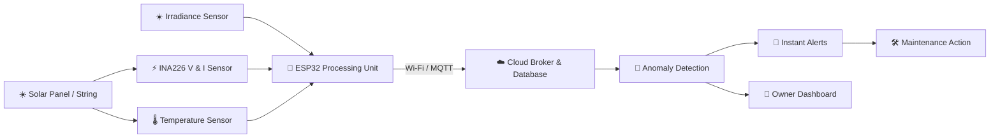

<div align="center">

# ☀️ SolarSense ⚡

### Low-Cost Real-Time Telemetry & Fault Alert System for Solar PV Plants and Rooftops


**☀️ Clean Energy &nbsp;|&nbsp; 🔔 Instant Alerts &nbsp;|&nbsp; 💰 Better ROI**

> *Detect Faster. Fix Sooner. Generate More.*

</div>

---

## 🔥 The Problem

Solar PV plant owners and residential rooftop users lose energy every day to **undetected faults, dust accumulation, and module degradation**. Manual inspection is **infrequent, slow, and expensive**, so problems often go unnoticed for weeks or months.

There is no **low-cost, automated, real-time telemetry solution** that alerts users instantly to performance anomalies. The result is lower ROI and slower adoption of green energy at the grassroots level.

## 💡 The Solution

**SolarSense** is a compact IoT monitoring system that continuously measures panel voltage, current, temperature, and sunlight, compares actual output against expected output, and **sends an instant alert** to the owner's phone when something is wrong, so faults are fixed in hours instead of months.

---

## ✨ Key Features

| | Feature | Description |
|---|---|---|
| ⚡ | **Real-Time Telemetry** | Live voltage, current, and power readings from the panel or string |
| 🔔 | **Instant Anomaly Alerts** | Push, SMS, or Telegram alerts when performance drops unexpectedly |
| 🧹 | **Dust / Soiling Detection** | Flags gradual output loss that points to dirty panels |
| 🌡️ | **Temperature Monitoring** | Tracks module temperature to spot hot spots and overheating |
| 📉 | **Degradation Tracking** | Long-term trend analysis of performance ratio |
| 📊 | **Visualization Dashboard** | Mobile/web dashboard with live graphs, history, and energy yield |
| 💸 | **Low Cost** | Built from affordable, widely available components |

---

## ⚙️ How It Works

```
 ┌──────────────┐     ┌──────────────┐     ┌──────────────┐     ┌──────────────┐
 │ 1. SENSE     │ ──▶ │ 2. TRANSMIT  │ ──▶ │ 3. ANALYZE   │ ──▶ │ 4. ALERT &   │
 │              │     │              │     │              │     │    VISUALIZE │
 └──────────────┘     └──────────────┘     └──────────────┘     └──────────────┘
  Measures V, I,       ESP32 sends data     Actual vs expected   Owner gets alerts
  temperature and      over Wi-Fi using     power is compared    and a clear
  sunlight             MQTT / HTTP          to detect anomalies  dashboard
```

1. **📡 Sense** – Sensors continuously measure voltage, current, panel temperature, and irradiance.
2. **🔌 Transmit** – The ESP32 sends readings to the cloud over Wi-Fi.
3. **🧠 Analyze** – Actual power output is compared with expected output to compute the performance ratio and detect anomalies.
4. **📱 Alert & Visualize** – The owner receives instant notifications and views trends on a dashboard.

---

## 🚨 Fault Classification Legend

| Color | Condition | Likely Cause | Action |
|:---:|---|---|---|
| 🔴 | **Critical Drop** | Faulty module, loose connection, shading, or inverter issue | Inspect immediately |
| 🟠 | **Hot Spot / Overheat** | Cell damage or poor ventilation | Inspect soon |
| 🟡 | **Gradual Loss** | Dust accumulation / soiling | Schedule cleaning |
| 🟢 | **Normal** | Operating as expected | No action needed |

---

## 🧩 System Components

| Component | Hardware | Role |
|---|---|---|
| 🔌 **Microcontroller** | ESP32 | Reads sensors, runs logic, sends data over Wi-Fi |
| ⚡ **Voltage / Current Sensor** | INA226 / INA219 | Measures panel voltage and current |
| 🌡️ **Temperature Sensor** | DS18B20 | Measures module back-surface temperature |
| ☀️ **Irradiance Reference** | LDR / small reference cell | Estimates sunlight to compute expected output |
| 🕒 **Real-Time Clock** | DS3231 (optional) | Accurate timestamps when offline |
| 💾 **Local Storage** | microSD (optional) | Buffers data if Wi-Fi is down |
| 🔋 **Power Supply** | Buck converter from panel / battery | Powers the monitoring unit |
| 📱 **Dashboard** | Web / mobile app | Live data, history, alerts |

---

## 🖼️ Sample Output

| Live Power Graph | Expected vs Actual | Alert Notification | Mobile Dashboard |
|:---:|:---:|:---:|:---:|
| Real-time V, I, P | Performance ratio trend | Instant fault message | Owner-friendly summary |

> 📌 *Add your images to an `/assets` folder and embed them here, e.g. ``*

---

## 🏗️ Architecture



---

## 🧠 Detection Logic (Concept)

```
Expected Power  = f(Irradiance, Module Temperature, Panel Rating)
Performance Ratio (PR) = Actual Power / Expected Power

PR sudden drop        →  🔴 Fault / shading / disconnection
PR slow steady decline →  🟡 Dust accumulation (soiling)
PR long-term decline   →  📉 Module degradation
High temp + low output →  🟠 Possible hot spot
```

> ⚠️ *Thresholds need calibration against real field data.*

---

## 🚀 Getting Started

```bash
# Clone the repository
git clone https://github.com/<your-username>/solarsense.git
cd solarsense

# Install backend dependencies
pip install -r requirements.txt

# Run the analysis pipeline on sample data
python analyze.py --input data/sample_telemetry.csv
```

> ⚠️ *This is a conceptual prototype. Code and hardware integration are under development.*

---

## 🗺️ Roadmap

- [x] Problem definition & system architecture
- [ ] ESP32 firmware for sensor reading
- [ ] Wi-Fi / MQTT data transmission
- [ ] Performance ratio calculation
- [ ] Alert system (Telegram / SMS / push)
- [ ] Web / mobile dashboard
- [ ] Soiling vs fault classification
- [ ] Field testing & calibration
- [ ] ML-based anomaly detection

---

## 🌍 Impact

- ⚡ **Recovers lost energy** by catching faults early
- 💰 **Improves ROI** for plant owners and rooftop users
- 🧹 **Optimizes cleaning schedules** instead of fixed routines
- 🏘️ **Makes monitoring affordable** at the grassroots level
- ♻️ **Supports green energy goals**

---

## 🛠️ Tech Stack

`C++ / Arduino` · `ESP32` · `INA226` · `DS18B20` · `MQTT` · `Python` · `NumPy / Pandas` · `Grafana / Web Dashboard` · `Telegram Bot API`

---

## 🤝 Contributing

Contributions, ideas, and feedback are welcome!

1. Fork the repo
2. Create your branch: `git checkout -b feature/awesome-feature`
3. Commit your changes: `git commit -m "Add awesome feature"`
4. Push and open a Pull Request

---

## 📄 License

Distributed under the MIT License. See `LICENSE` for details.

---

<div align="center">

### ☀️ SolarSense: *Detect Faster. Fix Sooner. Generate More.* ⚡

⭐ **Star this repo if you believe in affordable solar monitoring!** ⭐

</div>
